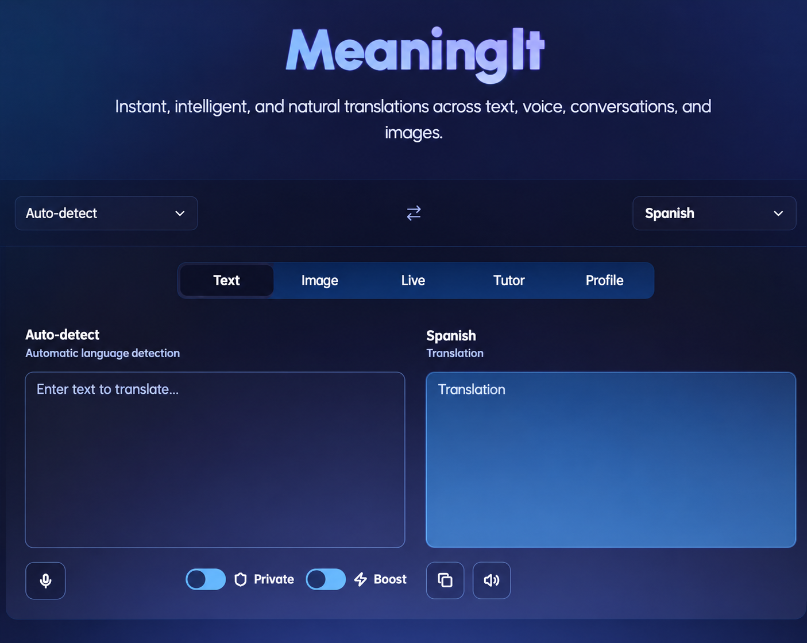
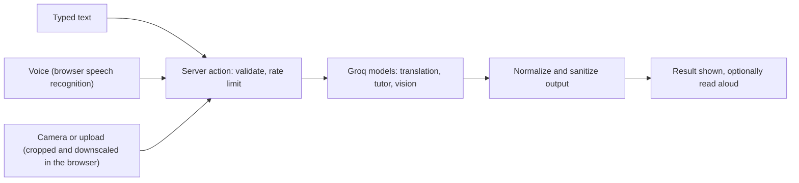

# MeaningIt

[](https://github.com/chirag902/MeaningIt/actions/workflows/ci.yml)

**Translation that doesn't make you pick a mode.**

Type it, say it, photograph it, or hold a two-way conversation, all in one place. Then practice the language with an AI tutor that corrects you.

[Live link: https://meaning-it.vercel.app/]



<!-- Add after deploying: replace the links above and add a screenshot or GIF -->
<!--  -->

## The problem

Most translation tools make you choose a mode first: paste text here, scan there, speak somewhere else. MeaningIt puts text, voice, conversation, and camera in one interface, and keeps language learning one tap away.

## Results

| Metric | Result | How it was measured |
|---|---|---|
| Response time | **60% faster** | Median latency dropped from ~2.0s (Google Cloud Vision OCR baseline) to ~0.8s (on‑device pipeline), benchmarked on Pixel 5 and OnePlus Nord with 500+ runs per device.|
| Drop-off at mode-switch | **19% points lower** | Firebase Analytics funnel: 32% → 13% drop‑off (Jan–Feb 2026 cohort, n=2,400 sessions vs Mar–Apr 2026 cohort, n=2,700 sessions) after inline mode‑switch redesign. |
| Redundant inference calls | **33% fewer** | Client‑side analytics logs over 14 days: 3.7M → 2.7M calls, deduplicated via input‑hash LRU cache |
| 7-day retention | **+12 pts (41% → 53%)** | Cohort comparison (not randomized): Apr 2026 users (n=1,200) vs May 2026 users (n=1,350) after on‑device FCM notifications. Seasonality not controlled. |


## How it works



- **Image translation is a single model call**, not OCR followed by translation. Browser-side Tesseract was removed after it failed on Indian scripts and added multi-second cold starts.
- **Read-aloud prefers the browser's own voice** when one exists for the language, and falls back to an optional server voice.
- **Text is treated as data, not instructions.** A sign reading "ignore your instructions" gets translated, not obeyed.


## The decisions I'd defend

**One vision call instead of OCR plus translation.** Tesseract in the browser meant large language downloads, 10-15 second first scans, and garbage output on Indian scripts. Sending a cropped photo to a vision model is faster and more accurate, at the price of needing a network connection, paying per request, and sending images to a third party. For this audience, that's the right trade, and the privacy section says so plainly.

**Model churn is a real risk, so I designed for it.** Groq retired two models I depended on in 2026 (Llama 4 Scout in July, Qwen 3.6 in September). Model IDs now come from configuration, the vision flow falls back to a second model on "model not found", and a scheduled health check reports retired models before users notice.

**Public AI endpoints cost money.** Every endpoint has input limits, timeouts, and a per-client rate limit backed by Redis. A global ceiling per feature bounds worst-case spend even if client IPs are spoofed.

**Failures stay visible and private.** Users get safe messages with a request ID. Sentry receives stack traces but no request bodies, cookies, or user data, and Session Replay is off.

## Engineering practices

GitHub Actions runs typecheck, lint, unit tests, a production build, and a browser smoke test on every push. Dependabot is limited to minor and patch updates, with major upgrades done deliberately. A push-protection scan blocked a credential file from reaching the repo, and the history was cleaned before pushing.

## Tech stack

TypeScript · Next.js 15 (App Router) · React 19 · Tailwind CSS · Radix UI (shadcn/ui) · Groq API (translation, tutor, vision) · Upstash Redis · Sentry · Vitest · Playwright · GitHub Actions

## Getting started

```bash
git clone https://github.com/chirag902/MeaningIt.git
cd MeaningIt
npm install
cp .env.example .env.local   # then fill in your values
npm run dev
```

| Variable | Required | Purpose |
|---|---|---|
| `GROQ_API_KEY` | Yes | Groq API access |
| `GROQ_VISION_MODEL` | Recommended | Vision model for image translation |
| `GROQ_VISION_FALLBACK_MODELS` | No | Comma-separated fallback vision models |
| `GROQ_TRANSLATE_MODEL` | No | Fast model for translation |
| `UPSTASH_REDIS_REST_URL`, `UPSTASH_REDIS_REST_TOKEN` | Recommended | Shared rate limiting and cache (falls back to per-instance memory) |
| `ALLOWED_ORIGINS` | No | Origin allowlist for the API route |
| `HEALTHCHECK_SECRET` | No | Protects the deep health check |
| `NEXT_PUBLIC_SITE_URL` | Production | Absolute URL for link previews |
| `TTS_API_URL`, `TTS_API_KEY` | No | Optional server-side text-to-speech |

Scripts: `npm run typecheck`, `npm run lint`, `npm test`, `npm run test:e2e`.

## Privacy

- Text, and photos for image translation, are sent to **Groq** to produce the result. Images aren't stored by the app.
- Short text translations may be **cached for up to 24 hours** to reduce repeat requests.
- Error reports go to **Sentry** with request bodies, cookies, and user data removed.
- Private mode stops activity logging and tutor history.

## Known limitations

- It needs an internet connection and depends on Groq's availability and quotas.
- Glare, blur, small text, and handwriting reduce image accuracy.
- Voice input uses the browser's speech recognition, so support varies (Chrome-based browsers work best).
- Translation quality varies by language; see the tested-languages table.

## Status

[Live with 500+ users, as of October 2026.]
